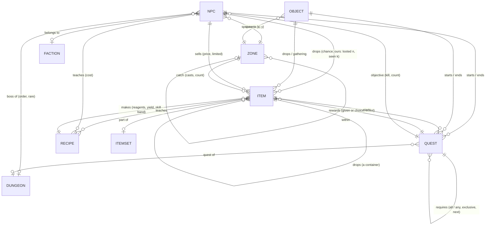

# DawnTools: the data

What DawnTools knows about the game, where each part of it comes from, where it is kept, and what leaves the
machine. The code's way in is `DT.DB` (`Core/DB.lua`). This page is the model; a section marked **planned** is
decided but not built yet. The work left, in order, is in `docs/PLAN-DATA.md`.

**In one paragraph.** DawnTools' download holds no game data (bar two files for the BiS tab, see 2). The game's
data lives in a database on each player's own machine (`DawnToolsDB.db`, "the store") and gets there three
ways: read from an addon installed on that machine (QuestieDB) or from the seed addon (`DawnTools_Seed`,
which only its keeper has); noted as the player plays; and, for everybody else, from guild members, a piece at
a time, once the player agreed to share the game database. Nothing of it has been seen working between two real
players yet.

## 1. The model

Things, by the game's own numbers: `item`, `npc`, `object`, `quest`, `zone` (area), `recipe` (spell), `dungeon`
(by a key made of its name), `faction`, `itemset`.



A relation is a name, what it starts from, what it points at, and what it carries. The list is `DB.RELS`
(`Core/DB.lua`); a test checks every relation names kinds that exist. Lua enforces nothing at runtime: "foreign
key" here means keyed by the game's numbers, documented, and checked by test.

| Relation | From → to | Carries | Answered today |
|---|---|---|---|
| `drops` | npc / object / item → item | chance %; ours: `n` looted, `k` seen | by item (all); by npc (dungeon bosses, and what we counted) |
| `sells` | npc → item | price, limited | by item |
| `rewards` | quest → item | given / choice, count | by item |
| `starts` | npc / object / item → quest | | from item |
| `makes` | recipe → item | reagents, yield, skill band | by item |
| `bossof` | npc → dungeon | rare | from npc |
| `ends`, `requires`, `objective`, `spawns`, `teaches`, `pickpocket`, `skinning`, `gathering`, `disenchants`, `partof`, `questof`, `keyof`, `catch`, `within`, `belongs`, `flight` | see `DB.RELS` | | **planned** as answers of `DB.Rel`. The tabs read what they need of these through `DB.Lib()` (below) |

### Asking

```lua
DT.DB.Get("item", 872)              -- { kind, id, name, level, ilvl, class, sub, src }  or nil
DT.DB.RelTo("drops", "item", 872)   -- who drops it: { { kind = "npc", id = 644, src = "shipped", chance = 3.9, n = 52, k = 2, ... }, ... }
DT.DB.Rel("starts", "item", 820)    -- what it starts: { { kind = "quest", id = 107, src = "questie" } }
DT.DB.ChanceText(fact)              -- "12%", "12%, seen 1 of 5 looted (20%)", "7 of 52 looted (13%), stated 12%"
DT.DB.Lib()                         -- the lists of NPCs, items, quests and objects, in QuestieDB's own shapes
```

`DB.Lib()` is what the World tabs read their long lists through: QuestieDB itself where it is installed, else
the store answering the same calls (`lib.Npc.GetAllIds()`, `Get(id, field)`, `GetAll(id, fields)`, `lib.Enum`,
`lib.Support.Get`), `lib.store = true`; `nil` where neither is there. One reader in each tab does for both. No
file outside `Core/DB.lua` and `Core/DBImport.lua` names `LibQuestieDB`.

Every fact says where it is from (`src`), ours first:

| `src` | What | Kept by DawnTools |
|---|---|---|
| `own` | I saw it in play (in the older stores, which tell mine from a member's) | yes |
| `guild` | learned in play by the guild: a member's, or (in the store, whose rows do not say whose they are) mine | yes |
| `shipped` | the dungeon list (name kept from when it was in the download: today rows of the store, source `oneforall`) | in the store |
| `questie` | QuestieDB: read live where installed, else its rows in the store | in the store |
| `oneforall`, `atlasloot` | read live while that addon is installed | AtlasLoot: never |
| `game` | the game client itself (an item's name and level) | cache only |

A drop chance is shown both ways: what a source states, and what we saw ("7 of 52 looted"). Ours leads from 50
looted on (`DB.ENOUGH`). Ours counts looted corpses only, since an empty corpse is never seen, so it reads
slightly high.

## 2. Sources and licences

| Source | Licence (as stated in its own files) | What is taken | How it gets into the store |
|---|---|---|---|
| QuestieDB | No single licence: its team accepts reuse under GPL-3 but cannot speak for every past contributor ("when in doubt … all rights reserved") | every field it has of an NPC, item, quest and object (the list is `DB.FIELDS`), cut short where long: up to 8 places and 16 steps of a path, 40 entries a list, 3 lines of what a quest asks. Not its translations. Also which map an area is drawn on, a quest's experience, its tables of flag and race bits | `Core/DBImport.lua`, on a machine that has QuestieDB: once per version of it, in the background. The owner's decision, on the Questie team's statement |
| SkillUp Forever | GPL-3.0-or-later | recipes, reagents, skill bands, vendor prices of reagents | `tools/craftskill.js` writes the seed addon's `CraftSkill.lua`; `Core/DBSeed.lua` writes it into the store where the seed addon is installed |
| OneForAll | GPL-3.0-or-later | dungeons, bosses, loot with chances | two ways into the store, as `boss:` rows: `tools/dungeons.js` → the seed addon's `Dungeons.lua`; and, on a machine that has OneForAll installed, read from it at login (`Core/DBSeed.lua`). Whichever is the later version is written, whole, never a mix |
| AtlasLootClassic | GPL-2 (no "or later") | boss loot, drop rates | live only; never stored, shipped or sent |
| Auctionator | (not to be read as a reference) | its price history, as a local fill-in | live only; never sent |
| GatherMate2, Questie, TomTom | various | node counts, zone lookups, waypoints | live only |
| (defaults) | owner's decision | stat weights for the BiS tab | `Data/BisProfiles.lua`, in the download as editable defaults. Not in the store, not sent |
| CMaNGOS classic-db | said to be GPL-3 with carve-outs; **its licence files are not read yet** | **planned:** drop chances of old-world mobs | nothing taken yet |

Never taken, in any way but a live read on the player's own machine: ForeverLevelingBiS, RareScanner,
ForeverFishing, ForeverDungeonJournal, Attune, AllTheThings, DBM (all rights reserved, or no licence).
Every copy is recorded in `THIRD_PARTY_LICENSES.txt`.

**Not being in the download does not change what a licence allows.** A row passed from one member's machine to
another's is a copy handed on, as a file in a zip is. For the GPL sources that is what their licence permits
(the notice travels with the addon every member has: `THIRD_PARTY_LICENSES.txt` and `LICENSE`). For QuestieDB
it rests on the Questie team's statement (decision D of the plan). The stat weights of BiS are kept out of the store.

### The seed addon

`Interface/AddOns/DawnTools_Seed/` is a folder beside DawnTools, in no download and no repository: the data
files the generators write (`CraftSkill.lua`, `Dungeons.lua`), a `Seed.lua` that hands their tables over as the
global `DawnToolsSeed`, and a `.toc`. On a machine that has it, `Core/DBSeed.lua` writes its tables into the
store at login, once per version of each source. From there they pass to the guild. Whoever keeps the seed
keeps it up to date:

```
node tools/craftskill.js     # from the installed SkillUp Forever
node tools/dungeons.js       # from the installed OneForAll
```

The tests read the same two files (`tests/run.lua` says so if they are missing).

## 3. What is kept on this computer (`DawnToolsDB`)

Learned in play (**L**), a cache of what the game client says (**C**), or how the addon is set up (**S**).

| Store | Key → record | Limit | |
|---|---|---|---|
| `db` | **the store**: the game database, see below | | L + base rows |
| `market.houses[H/A/X][item]` | latest price, quantity, time, observer; per day: observations | 14 days, 20,000 items, 16 a day | L |
| `quest.turned[character][quest]` | handed in (for repeatable ones) | | L |
| `food.mine / guild`, `crafts.mine / guild` | which character knows which recipes | | L |
| `inventory.chars[character]` | bags, bank as last seen | | L |
| `combat.deaths`, `combat.kills` | PvP records | 500 each | L |
| `item.known[item]` | quality, slot, stats, Equip lines | | C |
| `bis.base[character]` | capped stats without gear | | C |
| `market.favs`, `npc.favs`, `bis.pick / edit`, filters, window, tabs, profiles | | | S |
| `sync` | counters of what was sent and received | | S |

### The store

`DawnToolsDB.db = { v, origin, chunks = { [chunk] = text }, hash = { [chunk] = hash }, base = { [source] = version } }`.
Rows, not tables: a key, a time, a source, and its values as one text (`Core/DBLogic.lua`, pure and tested).
Rows live in chunks by what they are and their number (256 numbers to a chunk), each chunk one text in the saved
file with its rows in the order of their keys, so that two installs holding the same rows hold the same text
and the same hash. A chunk is taken apart only when a row of it is looked at.

| Key | Values | Source | Written by |
|---|---|---|---|
| `npc:<n>`, `item:<n>`, `quest:<n>`, `object:<n>` | `name;values`: the fields of `DB.FIELDS[kind]`, packed (`DBLogic.Pack`) | `questie` | `Core/DBImport.lua` |
| the same keys | `name;level;zone;x;y[;1][;m<map>]` and the like: a thing met in play that nothing knew (`DB.Sighting` reads it) | `guild` | `Modules/Finds.lua` |
| `zone:<area>` | the number of the map that area is drawn on | `questie` | import |
| `enum:npcFlags`, `enum:raceMaskById` | QuestieDB's own small tables | `questie` | import |
| `recipe:<spell>` | profession, learned at, yellow, green, grey, scroll, item made, how many, reagents | `skillup` | `Core/DBSeed.lua` |
| `vprice:<item>` | copper a vendor asks | `skillup` | seed |
| `boss:<n>` | dungeon, levels, boss, NPC, rare, items and chances | `oneforall` | seed |
| `base:<source>` | which version of the source the rows are of | that source | import, seed |
| `fp:<source>:<chunk>` | the fingerprint of that source's rows in that chunk (section 4) | that source | import, seed |
| `loot:<npc>:<origin>`, `oloot:<object>:<origin>` | times looted; per item how often it was in there | `guild` | `DB.Loot` |
| `bloot:<dungeon/boss>:<origin>` | the same, for a boss the list gives no NPC number | `guild` | `Modules/Dungeon.lua` |
| `qreward:<quest>` | money, xp, level seen at, items given, items to choose from; the newer sighting stands | `guild` | `Modules/Quest.lua` |
| `vendor:<item>` | price for one, limited or not, vendor's name, place: the cheapest seller this machine saw; between members the newer sighting stands | `guild` | `Market/Capture.lua` |
| `fcatch:<n>:<origin>` | casts, items caught and how many, lowest skill, the spot's name (`n`: a number made of that name) | `guild` | `Modules/Fish.lua` |

- **Base rows** (every source but `guild`) carry, for a time, the number of the source's version and the shape
  they are written in (`DBLogic.VersionTime`: QuestieDB 1.1.3 in shape 6 is 710103060). Every install that
  imports the same version writes the same text, so nothing of it needs passing between two that both have the
  source; and where two members have different versions, the later one's rows stand for the whole guild, and
  an import of the older one does not write over them (`DB.Fill`). Two builds of one version number are not
  told apart.
- **A base row stands over a sighting** under the same key (`DBLogic.Wins`): what a member without QuestieDB
  met, and could not know for known, never writes over QuestieDB's fuller row on anyone's machine, and gives way
  to it when it arrives. Between two rows of a kind the newer stands.
- **Counters** carry an origin: a random number per install, never a name. Mine are never taken from the wire.
- **Out of the store, for the tabs:** `DB.Lib()` (section 1) for NPCs, items, quests and objects; and
  `DT.Recipes`, `DT.CraftSkill`, `DT.VendorPrice`, `DT.Dungeons`, put together from the rows at login and when a
  guildmate's rows come (`DBSeed.Rebuild`, then the event `DT_DATA_UPDATE`). A row that is not of the shape is
  left out.
- **Moved in at 0.48.0** (each with a migration of what was saved, run once at login): boss loot, quest
  rewards, vendor prices, fishing catches, and what an installed OneForAll knows of dungeons. The older tables
  (`quest.seen`, `dungeon.seen / guild / more`, `market.vendors`, `fish.catches`) are gone, and with them
  `dungeon.guild`, which was keyed by a member's name.
- **Boss loot is counted once**, by `DB.Loot`, as every corpse is. Inside a dungeon or raid every loot window
  is counted whatever the group's loot method (as the Dungeons tab always did); outside, only where I see all
  of the loot.

## 4. What is sent to the guild

Nothing, until the player says yes in a popup. **One question and one switch for all of it** (from 0.47.0:
`DT.db.settings.share`, `DT:Shares()`, asked a little after login and by `/dt db`; Settings > General). With it
off: nothing sent, nothing taken in. A profile that is imported never carries it. Everything is an addon
message (`Core/Comms.lua`): at most 40 messages a minute, none in a fight, none in an instance unless allowed.

| Kind | What a line carries | Name sent |
|---|---|---|
| Game database | the rows of the store (section 3): the game's data as imported and seeded, what was met in play, loot counted under a random number | no |
| Market observations | house, item, price, quantity, time, observer | the observer's (can be made anonymous: Market's own setting) |
| Recipes known | character name, food item numbers, recipe numbers | yes (it is the point) |

Three kinds are left. Vendor prices, quest rewards, boss loot, the dungeon list and fishing catches are rows of
the game database since 0.48.0 and travel with it; their own messages are gone (a member on an older DawnTools
no longer exchanges those with an updated one). Market observations and recipes known still travel on the
guild channel and keep their own stores.

**Market passes on what it received:** an answer to a request holds everything the answerer has, other
members' observations with their names included. That is how a newcomer gets a price history; to be decided:
say so in the popup, or strip the names from passed-on observations.

"No name" means none is stored, sent as a field, or shown. The game itself tells every client who sent it a
message; that cannot be hidden.

**The game database** (`Core/DBSync.lua`). On
the guild channel goes one thing, the hash of the whole store, with the hello. Who hears a hash unlike their own
asks that member **by whisper** for the hashes of its chunks (`H?` / `H=`), then for each chunk that differs,
one at a time (`C?` / `C=`), and lays it into their own row by row (`DB.Take`, `DBLogic.Wins`). Recipes and
dungeons are asked for before the long lists of NPCs, items and quests. Several members are asked at once and
never two for the same chunk: one on its way from a member is left to them, and one that has come is not asked
of another who holds the very same. Whispers are packed; none carries a name. Only a chunk that was asked for is taken; nothing is asked in a fight. Everything held is passed on,
whoever it came from: that is what lets a new member fill up from anyone, also with what an offline member found
or seeded. Bounds on what is taken: seen ≤ looted, sane sizes, never my own origin from the wire, rows of the
wrong shape left out of the tables.

**Referees.** A machine that has a source itself (QuestieDB installed; the seed addon) can say what a row of
its version should be (`DB.Referee`). When a chunk it takes holds a row of that source and version that says
something else, it writes the right row one moment later than the wrong one (a base row's time ends in a free
digit for this: up to 9 times), so the right one is the newer, and stands wherever the two meet from then on.
A row of a later version than the machine's own is not its to judge. `/dt db` says how many were put right.
**Fingerprints.** Whoever writes a source's rows into the store (the import, the seed) writes beside them, a
chunk each, the hash of those rows' keys and values: `fp:<source>:<chunk>`, a row of that source itself
(`DB.Prints`). Fingerprints are asked for first in a fill. Before a chunk from another member is laid in
(`DB.Take`), its rows of a source and version are checked against the fingerprint held for that chunk: if they
do not add up to it, something in them is wrong, and as there is no telling which row, none of them is taken
from that member. So a machine WITHOUT the source can tell a broken copy from a whole one, and does not pass it
on. A row a referee put right still adds up (the fingerprint is of values, not of times). Rows of another
version than the fingerprint's, and chunks no fingerprint is held for, are taken as before. `/dt db` says how
many rows were refused.

Both mend a broken or meddled-with store; neither stops a member who means harm (who could as well claim a
later version, fingerprints and all). A chunk refused of a member is asked of them again at their next hello,
for as long as it differs. Not built yet: a hash per kind between the root and the chunks.

## 5. Measured

2026-11-19, on Forever: 60,000 rows are 2.6 MB of text, 2.5 MB of memory, 58 ms to read through. A whisper gets
through at about 700 bytes a second from one sender (the sending library's own pace), 200 of 200 arrived; a
character is addressed as the game names it ("First Surname").

```
/dt db bench make          60,000 test rows into the saved file; says their size and memory
/reload                    time it by hand, with and without the test rows
/dt db bench read          how long reading every row takes
/dt db bench clear
/dt db bench send 200      200 test whispers to the targeted player, to a name (send 200 Name), or with
                           nobody targeted to yourself: that goes by the server all the same
/dt db bench got           on the receiving character: how many came in, how fast, how many are missing
/dt db                     what the store holds: rows, chunks, size, hash, this install's origin, where the
                           base rows are from, how many recipes and bosses
```

Not measured: the size of the store with everything in it (base rows of a whole QuestieDB with their lists,
recipes, dungeons), how long the import takes, and how long a new member's first fill takes at 700 bytes a
second. `/dt db` after the import gives the first; the plan's step 1 asks for the rest.
